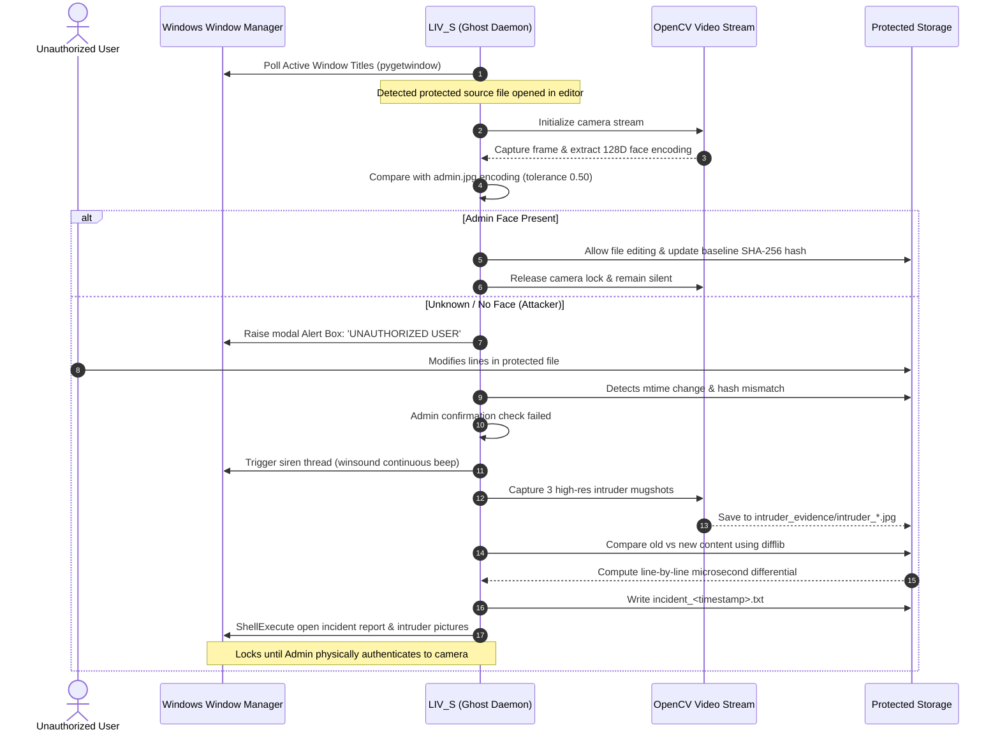
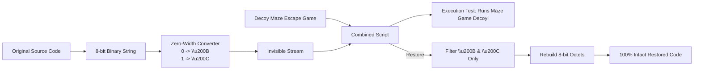

# 🛡️ IRIS
### *Next-Generation Endpoint Protection, Biometric Guardian & Contextual Cryptographic Defense*

[](https://microsoft.com)
[](https://python.org)
[](#system-architecture)
[](#1-environmental-security-module-env_s)
[](#2-live-biometric-guardian-module-liv_s)
[](#3-concealment--decoy-security-module-con_s)

---

## 📌 Executive Summary

Modern cybersecurity heavily relies on static encryption keys, master passwords, or isolated permission models that fail against shoulder surfing, unauthorized physical access, insider tampering, and runtime memory extraction. 

**Sentinel AI (IRIS)** introduces a paradigm shift in endpoint defense through a **Tri-Shield Unified Security Framework**:

1. **`ENV_S` (Environmental Security)**: Ephemeral geofenced encryption derived from dynamic environmental entropy (financial market delta, hardware master audio thresholds, and calendar epoch).
2. **`LIV_S` (Live Biometric Guardian)**: Silent background surveillance daemon ("Ghost Mode") providing zero-trust facial telemetry, active file modification tracking, automated forensic evidence capture, and self-defending process hooks.
3. **`CON_S` (Concealment Security)**: Steganographic source code cloaking that compiles sensitive code into zero-width invisible Unicode characters embedded inside fully functional decoy games.

```
                              ┌──────────────────────────────────────────────┐
                              │           SENTINEL AI / IRIS CORE            │
                              │           Unified Cyber Defense              │
                              └──────────────────────┬───────────────────────┘
                                                     │
                 ┌───────────────────────────────────┼───────────────────────────────────┐
                 │                                   │                                   │
                 ▼                                   ▼                                   ▼
   ┌───────────────────────────┐       ┌───────────────────────────┐       ┌───────────────────────────┐
   │           ENV_S           │       │           LIV_S           │       │           CON_S           │
   │  Environmental Cryptography│       │  Live Biometric Guardian  │       │  Steganographic Cloaking  │
   ├───────────────────────────┤       ├───────────────────────────┤       ├───────────────────────────┤
   │ • Dynamic Entropy Sensors │       │ • Ghost Mode Surveillance │       │ • Zero-Width Unicode Bit  │
   │ • Ephemeral Fernet Keys   │       │ • Continuous Face Match   │       │ • Maze Game Decoy Engine  │
   │ • Geofenced File Vaults   │       │ • Instant Siren & Lockout │       │ • Binary Source Rebuilder │
   │ • In-Place Shredding      │       │ • Live Diff Forensics     │       │ • Lossless Recovery       │
   └───────────────────────────┘       └───────────────────────────┘       └───────────────────────────┘
```

---

## 🛑 Problem Statement

Standard endpoint security mechanisms exhibit fundamental vulnerabilities in real-world scenarios:

- **Static Key Vulnerability**: Hardcoded passwords, passphrases, and fixed cryptographic keys can be stolen via memory dumps, keyloggers, or social engineering.
- **Shoulder Surfing & Unattended Workstations**: Once an authorized operator steps away or unlocks an endpoint, sensitive documents and source code remain completely exposed to co-located threats or shoulder surfers.
- **Silent Tampering**: Unauthorized changes made to local scripts, config files, or sensitive proprietary algorithms often go unnoticed until build failure or deployment exploitation.
- **Obvious Encryption Signatures**: Encrypted archives (`.zip`, `.gpg`, `.enc`) explicitly notify attackers that valuable data exists at that location, making them prime targets for exfiltration and offline brute-force attacks.

---

## 💡 The Sentinel Solution

Sentinel AI solves these attack vectors using three orthogonal defense mechanisms:

| Attack Vector | Traditional Defense | Sentinel AI Countermeasure |
| :--- | :--- | :--- |
| **Physical Tampering** | Password prompt on startup | **Continuous Biometric Validation (`LIV_S`)**: Monitors webcam in the background; detects face match before allowing read/write operations. |
| **Exfiltration & Dump** | Static AES-256 with password | **Contextual Environmental Encryption (`ENV_S`)**: Encryption keys are ephemeral, derived from real-time environmental sensors (market ticks + audio hardware states). |
| **Forensic Analysis** | Obfuscated binaries / `.enc` | **Steganographic Decoy Injection (`CON_S`)**: Source code is converted into invisible zero-width Unicode characters inside a playable game script. |
| **Unauthorized Modification** | Git tracking / manual review | **Real-Time Diff Forensic Capture**: Instant microsecond differential audit logs generated alongside webcam snapshots of the intruder. |

---

## 🏛️ System Architecture

```mermaid
graph TD
    subgraph UI ["Sentinel Unified Interface & Controller"]
        UI_MAIN["Cyberpunk HUD Canvas (Tkinter)"]
        UI_MAIN -->|Launch| ENV_S
        UI_MAIN -->|Launch| LIV_S
        UI_MAIN -->|Launch| CON_S
    end

    subgraph ENV_MODULE ["ENV_S : Contextual Cryptographic Vault"]
        S_FIN["Financial Index Sensor (S&P 500 AlphaVantage API)"]
        S_AUD["Hardware Audio Sensor (Windows Core Audio API)"]
        S_DAT["Temporal Sensor (Date / Time Stamp)"]
        
        S_FIN & S_AUD & S_DAT --> CTX_ENGINE["Context Synthesis Engine"]
        CTX_ENGINE -->|SHA-256 + URLSafe Base64| KEY_GEN["Ephemeral Fernet Key"]
        TARGETS["User Target Files / Folders"] --> ZIP["Payload Archiver"]
        ZIP --> CIPHER["Fernet Symmetric Cipher"]
        KEY_GEN --> CIPHER
        CIPHER --> VAULT["vault.geofenced"]
    end

    subgraph LIV_MODULE ["LIV_S : Live Biometric Guardian"]
        BAT["sentinel.bat Controller"] -->|Setup Check| GHOST["godmod.py (Ghost Process)"]
        GHOST --> DETACH["FreeConsole() + Stdio Detach"]
        GHOST --> SELF_LOCK["msvcrt Native File Lock"]
        GHOST --> WIN_HOOK["win32api Console Ctrl Hook"]
        
        CAM["Webcam (OpenCV)"] --> FACE_REC["Face Recognition Engine (128D Embeddings)"]
        ADMIN_REF["admin.jpg Reference"] --> FACE_REC
        WIN_POLL["pygetwindow Focus Monitor"] --> EVENT_DETECT{"Protected File Active?"}
        
        EVENT_DETECT -- No --> IDLE["Idle State (Release Camera)"]
        EVENT_DETECT -- Yes --> AUTH_CHECK{"Admin Face Verified?"}
        
        AUTH_CHECK -- Yes --> ALLOW["Allow Read / Write & Refresh State"]
        AUTH_CHECK -- No --> SIREN["Trigger Siren (winsound)"]
        SIREN --> MUGSHOT["Snap 3x Intruder Evidence"]
        SIREN --> DIFF_ENG["difflib Modification Delta Engine"]
        DIFF_ENG --> REPORT["Generate incident_<timestamp>.txt"]
    end

    subgraph CON_MODULE ["CON_S : Concealment & Steganography Engine"]
        SOURCE["Source Code / Scripts"] --> BIT_STREAM["text_to_bits()"]
        BIT_STREAM --> INVIS["bits_to_invisible() (\\u200B / \\u200C)"]
        GAME_DECOY["Maze Escape Game Decoy Engine"] --> MERGE["Decoy + Zero-Width Payload"]
        MERGE --> LOCKED_FILE["Playable Steganographic File"]
        LOCKED_FILE -->|Unlock Pipeline| EXTRACT["invisible_to_bits()"]
        EXTRACT --> RESTORE["bits_to_text() (Restored Source)"]
    end
```



---

## 🚀 Module Deep Dive & Workflow

### 1. Environmental Security Module (`ENV_S`)
*File Reference: `ENV_S/envsoft.py`*

`ENV_S` introduces context-bound encryption where decryption can only succeed when physical and temporal conditions match the exact environment in which the data was sealed.

#### How It Works:
1. **Dynamic Entropy Harvesting**:
   - **Market Delta**: Fetches the latest S&P 500 real-time fluctuation percentage via AlphaVantage API.
   - **Endpoint Volume**: Reads system master output volume scalar from Windows Core Audio endpoint via `pycaw`.
   - **Temporal Epoch**: Reads current system calendar day.
2. **Key Synthesis**:
   $$\text{Context} = \text{SP500\_Change} \parallel \text{Master\_Volume} \parallel \text{YYYY-MM-DD}$$
   $$\text{Key} = \text{Base64URLSafe}(\text{SHA256}(\text{Context}))$$
3. **Atomic Vault Packaging**:
   - Compresses all targeted files and subdirectories into an in-memory or temporary `.zip`.
   - Encrypts via `cryptography.fernet.Fernet` with the synthesized key.
   - Prepends proprietary header `GEOFENCEv1\n`.
   - Shreds/removes original target files from the host drive.
4. **Decryption Polling**:
   - The recipient endpoint must match the environmental state within a 50-cycle polling window to restore `payload.zip` and extract contents back into place.

---

### 2. Live Biometric Guardian Module (`LIV_S`)
*File Reference: `LIV_S/godmod.py`, `LIV_S/setup.py`, `LIV_S/sentinel.bat`*

`LIV_S` operates as an intelligent endpoint defense monitor that sits invisibly between the OS, the user's active windows, and the physical webcam.

#### Workflow & Defense Pipeline:



#### Key Hardening Capabilities:
- **Ghost Process Architecture**: Detaches from the Windows console host (`ctypes.windll.kernel32.FreeConsole()`) and suppresses standard output/error streams.
- **Process Anti-Kill Protection**: Employs `win32api.SetConsoleCtrlHandler` to trap termination signals (`CTRL_CLOSE_EVENT`, `CTRL_LOGOFF_EVENT`, `CTRL_SHUTDOWN_EVENT`). If an intruder tries to kill the process, it verifies admin presence before consenting to shutdown.
- **Script Self-Lock**: Locks its own execution file via low-level Windows file locking (`msvcrt.locking` with `msvcrt.LK_NBLCK`) to block on-disk script deletion while active.
- **Microsecond Live Diff Telemetry**: Uses `difflib.ndiff` to pinpoint every inserted or deleted character, recording exact timestamps for forensic investigation.

---

### 3. Concealment & Decoy Security Module (`CON_S`)
*File Reference: `CON_S/setup.py`, `CON_S/lock.py`, `CON_S/unlock.py`, `CON_S/stealth_engine.py`*

`CON_S` implements advanced Unicode steganography. Rather than locking files with visible encryption signatures, it transforms sensitive code into an entirely harmless, playable terminal game.



#### Technical Mechanics:
- **Zero-Width Character Mapping**:
  - `ZERO` = `\u200B` (Zero Width Space)
  - `ONE` = `\u200C` (Zero Width Non-Joiner)
- **Visual Discretion**: The file appears completely empty of secrets in text editors (VS Code, Notepad, Vim), rendering only the decoy game source code.
- **Execution Viability**: Running `python target.py` executes the interactive Maze Escape game without any syntax errors or hints that proprietary code is hidden inside.

---

## 🌟 Feature Matrix

| Feature | `ENV_S` | `LIV_S` | `CON_S` |
| :--- | :---: | :---: | :---: |
| **GUI Configuration Utility** | ✅ Cyberpunk Tkinter HUD | ✅ One-Time Setup Modal | ✅ Stealth Console GUI |
| **Silent Background Execution** | — | ✅ Ghost Mode (`pythonw`) | — |
| **Facial Biometrics Authentication** | — | ✅ 128D dlib Landmark Matching | — |
| **Intruder Photo Capture** | — | ✅ Multi-frame High-Res Capture | — |
| **Tamper Detection Siren** | — | ✅ Continuous Hardware Beep | — |
| **Audit Logging & Forensic Diff** | — | ✅ Line-by-Line Microsecond Trace | — |
| **Decoy Disguise** | — | — | ✅ Playable Python Game |
| **Dynamic Key Generation** | ✅ S&P 500 + Audio + Date | — | — |
| **File / Directory Support** | ✅ Files & Folders | ✅ 30+ Code & Text Formats | ✅ Text & Source Code |
| **Self-Defense Locking** | — | ✅ Native `msvcrt` File Lock | — |

---

## 📂 Project Structure

```
Sentinel AI/
├── CON_S/                              # Concealment Security Module
│   ├── game_engine.py                  # Generates decoy maze game source
│   ├── lock.py                         # CLI encoder: converts source to zero-width decoy
│   ├── sentinel.bat                    # One-click launcher for CON_S UI
│   ├── setup.py                        # CON_S GUI controller (Lock / Unlock UI)
│   ├── stealth_engine.py               # Core binary <-> invisible Unicode codec
│   └── unlock.py                       # CLI decoder: extracts & reconstructs original source
│
├── ENV_S/                              # Environmental Security Module
│   ├── envsoft.py                      # Core ENV_S engine (GUI, sensors, Fernet cipher)
│   └── logo.png                        # HUD entity graphic
│
├── LIV_S/                              # Live Biometric Surveillance Module
│   ├── admin.jpg                       # Authorized administrator facial baseline photo
│   ├── godmod.py                       # Main background daemon (Ghost surveillance)
│   ├── intruder_evidence/              # Auto-created vault for forensic mugshots & diff logs
│   ├── sentinel.bat                    # Intelligent launcher (Setup vs. Ghost selector)
│   ├── setup.py                        # First-run protected file picker & b64 config encoder
│   ├── test.py                         # Experimental verification suite
│   └── TODO.md                         # Module status and checklist
│
└── README.md                           # Master Project Documentation
```

---

## 🛠️ Prerequisites & Installation

### Operating System:
- **Windows 10 / 11** (Utilizes Windows Win32 APIs, `msvcrt`, `winsound`, and Core Audio endpoints).

### Dependencies & Setup:

1. **Clone the Repository**:
   ```powershell
   git clone https://github.com/jayxvj/IRIS.git "Sentinel AI"
   cd "Sentinel AI"
   ```

2. **Set Up a Python Virtual Environment**:
   ```powershell
   python -m venv venv
   .\venv\Scripts\activate
   ```

3. **Install Required Libraries**:
   ```powershell
   pip install opencv-python dlib face-recognition cryptography requests pycaw comtypes pygetwindow pywin32 pillow
   ```

   > [!TIP]
   > On Windows, installing `dlib` requires CMake and Visual Studio C++ Build Tools. Alternatively, pre-compiled wheels for your Python version can be installed.

---

## 🎮 Quickstart Guide

### 1. Launching the Master HUD (`ENV_S`)
Run the unified Sentinel interface:
```powershell
python .\ENV_S\envsoft.py
```
- Click **"+ FILES"** or **"+ FOLDER"** to select targets.
- Click **"INITIALIZE"** to seal files into `vault.geofenced`.
- Access **"LIVE SECURITY"** or **"CONCEAL SECURITY"** directly from the top navigation bar.

To restore a vault:
```powershell
python .\ENV_S\envsoft.py decrypt
```

---

### 2. Launching Biometric Guardian (`LIV_S`)
1. Place a clear frontal photo of the authorized administrator at:
   `LIV_S/admin.jpg`
2. Run the guardian controller:
   ```powershell
   .\LIV_S\sentinel.bat
   ```
   - **First Launch**: Automatically triggers the file picker modal. Select files to monitor (Python scripts, config files, source code).
   - **Subsequent Runs**: Automatically launches `godmod.py` in the background with no console window.
3. Open any protected file in an editor (e.g., VS Code or Notepad).
   - Sentinel detects file activity and looks for your face.
   - If an unauthorized person attempts to edit, the siren sounds, intruder evidence is snapped, and full forensic diff reports are generated.

---

### 3. Launching Steganographic Concealment (`CON_S`)
Launch the GUI:
```powershell
.\CON_S\sentinel.bat
```
- Click **"LOCK / CONCEAL FILE"** and choose your target script.
  - The script's contents are replaced with the interactive Maze Escape game containing the invisible payload.
- Click **"UNLOCK / RESTORE FILE"** to extract the invisible Unicode payload and recover your original code.

Or via CLI:
```powershell
# Lock a file
python .\CON_S\setup.py "path\to\script.py" lock

# Unlock a file
python .\CON_S\setup.py "path\to\script.py" unlock
```

---

## 🛡️ Threat Mitigation & Forensic Analysis

```
+---------------------------------------------------------------------------------------+
|                                  INTRUSION DETECTED                                   |
|                                                                                       |
|  [!] Timestamp : 2026-10-23 14:48:12.891                                              |
|  [!] File      : C:/Users/User/Documents/Projects/algo.py                             |
|  [!] Evidence  : LIV_S/intruder_evidence/intruder_1729675092_0.jpg                     |
|                                                                                       |
|  LIVE FILE MODIFICATION TRACE:                                                        |
|  [-] line 42: API_KEY = "sk-live-98a7sd8f7a6sdf8a7sd"                                 |
|  [+] line 42: API_KEY = "sk-hacked-attacker-exfil"                                    |
+---------------------------------------------------------------------------------------+
```

When an intrusion occurs under `LIV_S`:
1. **Zero Evasion**: The console handler prevents the intruder from dismissing the warning via standard console closing shortcuts.
2. **Immediate Evidence Capture**: 3 sequential frames are recorded to `intruder_evidence/intruder_<timestamp>_<index>.jpg`.
3. **Audit Trail**: An incident log (`incident_<timestamp>.txt`) is created with exact time deltas down to the millisecond.
4. **Shell Display**: The report and captured images are automatically launched on screen for immediate inspection once the administrator verifies their identity.

---

## 🔮 Future Scope & Roadmap

- [ ] **Cross-Platform Support**: Abstract Win32-specific APIs (`pycaw`, `winsound`, `win32gui`) to provide cross-platform compatibility across Linux (via ALSA/PulseAudio, X11/Wayland hooks) and macOS.
- [ ] **Multi-Admin & Team Encodings**: Support multiple authorized facial profiles stored with biometric salt and irreversible cryptographic hashing.
- [ ] **Behavioral Biometrics**: Integrate keystroke dynamics and mouse movement anomaly detection for continuous non-camera authentication.
- [ ] **Hardware Security Key Integration (FIDO2 / YubiKey)**: Combine environmental context with hardware physical security keys for quad-factor validation.
- [ ] **Encrypted Decentralized Evidence Sync**: Automatically dispatch intruder forensic reports and captured snapshots to an encrypted off-site webhook or cloud storage (Telegram Bot API / S3 Bucket).
- [ ] **Polymorphic Decoy Engine**: Broaden `CON_S` decoy library beyond Maze games to include realistic utilities (e.g., system diagnostic scripts, benchmark runners, calculator tools).

---

## 📜 License

This project is licensed under the [MIT License](LICENSE).

---

## ⚠️ Disclaimer

*Sentinel AI (IRIS) is an experimental cybersecurity and endpoint protection suite designed for academic research, personal defense, and source code protection. Ensure compliance with local privacy regulations and consent requirements when deploying continuous biometric facial surveillance devices.*
